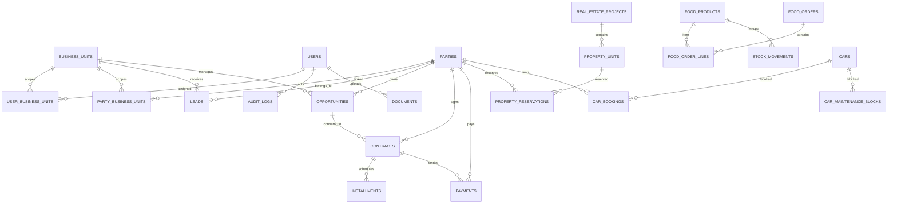

# Database Schema — SAWA UNITED

## 1. قواعد التصميم

- Primary Keys من نوع UUID النصي في MVP؛ يوصى بـ UUID native في PostgreSQL مستقبلًا.
- المال يستخدم `NUMERIC(18,2)` والكميات `NUMERIC(14,3)`، لا Floating Point.
- حذف منطقي للسجلات الرئيسية (`active` أو `status`)؛ تجنب الحذف المادي للسجلات المالية والقانونية.
- لكل جدول تشغيلي `created_at` و`updated_at` ما عدا سجلات التدقيق والجداول الرابطة.
- كل معاملة تحفظ عملتها الأصلية.
- ملفات المستندات خارج DB، والجدول يحتفظ بالـ metadata والـ hash.

## 2. ER Diagram



## 3. قاموس الجداول

| الجدول | المفاتيح والحقول المهمة | الغرض |
|---|---|---|
| `business_units` | `id`, `code`, `name_ar`, `name_en`, `active` | العلامات/وحدات الأعمال |
| `countries` | `code`, `default_currency`, `timezone` | الدول والإعدادات المحلية |
| `users` | `id`, `email`, `password_hash`, `role`, `active` | حسابات الموظفين |
| `user_business_units` | PK مركب: `user_id`, `business_unit_id` | نطاق النشاط للمستخدم |
| `session_tokens` | `token_hash`, `expires_at`, `revoked` | جلسات مصادقة قابلة للإبطال |
| `parties` | `display_name`, `party_type`, `phone`, `email`, `country_code`, `roles` | قاعدة موحدة للعملاء والأطراف |
| `party_business_units` | PK مركب: `party_id`, `business_unit_id` | ربط الطرف بالنشاط المسموح |
| `leads` | `party_id`, `business_unit_id`, `source`, `status` | استفسارات أولية |
| `opportunities` | `party_id`, `business_unit_id`, `stage`, `expected_value`, `currency` | فرص تجارية مؤهلة |
| `contracts` | `contract_no`, `party_id`, `business_unit_id`, `status`, `total_value`, `currency`, `version` | دورة حياة العقد |
| `installments` | `contract_id`, `due_date`, `amount`, `status` | جدول الاستحقاقات (قاعدة البيانات جاهزة؛ API تفصيلي لاحق) |
| `payments` | `direction`, `party_id`, `contract_id`, `amount`, `currency`, `method` | المقبوضات والمدفوعات |
| `real_estate_projects` | `name`, `developer_party_id`, `country_code`, `city` | المشروعات العقارية |
| `property_units` | `project_id`, `unit_code`, `area_sqm`, `price`, `status` | الوحدات العقارية |
| `property_reservations` | `unit_id`, `party_id`, `start_at`, `expires_at`, `status`, `deposit_amount` | حجز وحدات ومنع التداخل |
| `food_products` | `sku`, `name`, `stock_quantity`, `reorder_level`, `currency` | كتالوج الأغذية والمخزون المملوك |
| `food_orders` | `business_model`, `customer_party_id`, `supplier_party_id`, `goods_total`, `commission_amount` | طلب مباشر أو وساطة |
| `food_order_lines` | `order_id`, `product_id`, `quantity`, `unit_price` | تفاصيل الطلب |
| `stock_movements` | `product_id`, `order_id`, `movement_type`, `quantity` | سجل حركة المخزون |
| `cars` | `registration_no`, `make`, `model`, `country_code`, `daily_rate`, `status` | أصول الأسطول المملوك |
| `car_bookings` | `car_id`, `party_id`, `start_at`, `end_at`, `total_amount`, `status` | حجوزات التأجير |
| `car_maintenance_blocks` | `car_id`, `start_at`, `end_at`, `reason` | فترات حظر الصيانة |
| `tasks` | `business_unit_id`, `assigned_to`, `due_at`, `status`, `related_type/id` | مهام ومتابعات |
| `documents` | `storage_key`, `sha256`, `entity_type/id`, `business_unit_id` | بيانات الملفات الخاصة |
| `audit_logs` | `user_id`, `action`, `entity_type/id`, `details`, `ip_address` | سجل التدقيق |

## 4. القيود والفهارس

- Unique: `users.email`, `business_units.code`, `food_products.sku`, `cars.registration_no`, `contracts.contract_no`, `food_orders.order_no`, `car_bookings.booking_no`.
- Unique: `(project_id, unit_code)` في الوحدات.
- Index: الطرف حسب الاسم/الهاتف/البريد، الفرص حسب النشاط والحالة، العقود حسب النشاط والحالة، الحجوزات حسب الأصل والفترة.
- Foreign Keys مع `ON DELETE CASCADE` للجداول الرابطة/تفاصيل الطلب، وقيود مناسبة للعلاقات القانونية والمالية.
- PostgreSQL: Exclusion constraint لمنع overlap للفترة `[start,end)` لوحدة عقارية أو سيارة.

## 5. قيود PostgreSQL الزمنية

تتطلب `btree_gist` ثم:

```sql
ALTER TABLE property_reservations
ADD CONSTRAINT property_reservations_no_overlap
EXCLUDE USING gist (
  unit_id WITH =,
  tstzrange(start_at, expires_at, '[)') WITH &&
) WHERE (status IN ('pending','confirmed'));

ALTER TABLE car_bookings
ADD CONSTRAINT car_bookings_no_overlap
EXCLUDE USING gist (
  car_id WITH =,
  tstzrange(start_at, end_at, '[)') WITH &&
) WHERE (status IN ('pending','confirmed','active'));
```

ويضاف قيد منفصل يمنع تعارض حجز السيارة مع `car_maintenance_blocks` في طبقة الأعمال، أو يعالج بجدول resource-block موحد عند التوسع.

## 6. اعتبارات ترقية المخطط

`Base.metadata.create_all()` للتطوير الأولي فقط. في الإنتاج تُستخدم Alembic migrations مراجعة ومختبرة. يجب اعتماد استراتيجية ترحيل بيانات legacy، وفترة dual-write أو تجميد الإدخال أثناء النقل، والتحقق من عدد السجلات والمبالغ قبل وبعد النقل.
