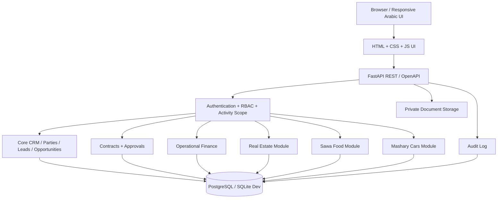

# التصميم التقني التفصيلي — SAWA UNITED BMS

**الإصدار:** 1.0 MVP  
**المرجعية:** PRD/SRS المعتمدة للمجموعة  
**النمط:** Modular Monolith · REST API · Relational Database · Arabic RTL Web UI

## 1. القرارات المعمارية

1. تطبيق واحد بوحدات نطاق واضحة؛ لا Microservices في المرحلة الحالية.
2. هوية موحدة للطرف التجاري، مع جدول ربط `party_business_units` لعزل ظهوره حسب النشاط.
3. كل عقد أو فرصة أو حركة مالية تتضمن نشاطًا ودولة وعملة.
4. قواعد عمل مستقلة للعقار والغذاء والسيارات؛ لا يتم توحيد مساراتها قسرًا.
5. SQLite للتطوير السريع فقط؛ PostgreSQL قاعدة الإنتاج المستهدفة.
6. الملفات في مخزن خاص لا يخدمه Static Server، مع بيانات وصفية في قاعدة البيانات.
7. العمليات الحساسة تسجل في `audit_logs`، ولا يوجد حذف نهائي للعقود أو الحركات المالية عبر API.

## 2. البنية المنطقية

## 3. الوحدات وحدود المسؤولية

| النطاق | المسؤولية | أهم الكيانات |
|---|---|---|
| Core | الدول، العلامات/الأنشطة، الهوية، الصلاحيات، CRM | BusinessUnit, Country, User, Party, Lead, Opportunity |
| Contracts | دورة حياة التعاقد والإصدارات | Contract, Installment |
| Finance | المقبوضات والمدفوعات التشغيلية | Payment |
| Real Estate | المطور، المشروع، الوحدة والحجز | RealEstateProject, PropertyUnit, PropertyReservation |
| Sawa Food | SKU والمخزون والبيع المباشر والوساطة | FoodProduct, FoodOrder, FoodOrderLine, StockMovement |
| Mashary Cars | أصل السيارة والتوافر والحجز والصيانة | Car, CarBooking, CarMaintenanceBlock |
| Cross-cutting | الملفات والمهام والتدقيق والجلسات | Document, Task, AuditLog, SessionToken |

## 4. قواعد العمل المحورية

### 4.1 تعدد الدول والعملات

الدول المبدئية: EG/EGP، MA/MAD، KW/KWD، AE/AED، SA/SAR. بقية الدول تضاف من واجهة API الإدارية. كل مبلغ يخزن في `NUMERIC` مع `currency`؛ يمنع جمع مبالغ بعملات مختلفة في تقرير واحد دون سعر صرف موثق. النسخة الحالية تعرض المبلغ بعملته الأصلية ولا تنفذ تحويل FX محاسبيًا.

### 4.2 نطاق العميل والصلاحيات

- `super_admin` و`group_manager`: رؤية المجموعة بحسب السياسة.
- الأدوار التشغيلية: يجب إسناد نشاط واحد على الأقل.
- الطرف التجاري المقيد يظهر فقط لمستخدمي النشاط/الأنشطة المرتبطة به.
- كل وحدة تشغيلية تتحقق من دور المستخدم ونطاق نشاطه قبل القراءة أو الكتابة.
- صلاحيات المسؤوليات المالية والعقود أكثر تقييدًا من صلاحية إدخال العملاء.

### 4.3 العقود

المسار المدعوم: `draft → review → approved → sent → signed → active → expired/terminated` مع مسارات رجوع محدودة للمراجعة. العقد الموقع لا يعدل في موضعه؛ الإصدارات والملحقات يجب أن ترتبط بالعقد الأصل.

### 4.4 العقارات

لا ينشأ حجز متداخل لوحدة نشطة خلال الفترة نفسها. تستخدم المعاملة قفل صف الوحدة `SELECT FOR UPDATE` عند توفر قاعدة بيانات تدعم ذلك. في PostgreSQL تضاف قيود Exclusion باستخدام `btree_gist` كما في migration. يلزم تأكيد قواعد انقضاء الحجز المؤقت قبل الإنتاج.

### 4.5 Sawa Food

- `direct`: المخزون ملك للشركة؛ عند تنفيذ الطلب يجري التحقق من الكمية ثم ترحيل حركة خروج وتحديث الرصيد.
- `brokerage`: لا يتم خصم أي مخزون مملوك؛ يسجل إجمالي البضاعة وعمولة الشركة كقيمة تشغيلية منفصلة.
- يختار نموذج العمل على مستوى الطلب، لا على مستوى العلامة.

### 4.6 Mashary Cars

الأسطول مملوك للشركة في النسخة الأولى. لا يقبل حجز متداخل لحالة pending/confirmed/active ولا حجز يتعارض مع فترة صيانة مجدولة. يجب استكمال وثائق الاستلام والتسليم ووديعة التأمين والأضرار قبل الاعتماد التجاري.

## 5. الأمن

- كلمات المرور تخزن باستخدام PBKDF2-HMAC-SHA256 مع Salt فريد.
- جلسات عشوائية عالية الإنتروبيا؛ يحفظ Hash الجلسة فقط في قاعدة البيانات.
- Cookie: HttpOnly + SameSite=Lax؛ يلزم Secure خلف HTTPS في الإنتاج.
- الاستجابات الإدارية لا تعيد `password_hash`.
- عزل البيانات حسب الدور والنشاط على مستوى API وليس الواجهة فقط.
- الملفات الخاصة تتطلب جلسة صالحة ونطاق نشاط؛ يسمح PDF والصور وDOCX وXLSX حتى 15MB مع فحص ترويسة التوقيع.
- سجل تدقيق لعمليات الدخول وإنشاء السجلات والاعتمادات والحركات الحساسة.

**فجوات إنتاجية يجب إكمالها:** MFA، Rate limiting، سياسة CSRF صريحة، فحص ملفات AV، إدارة الأسرار المؤسسية، مراقبة مركزية، اختبارات OWASP، وسياسة احتفاظ/حذف بيانات موثقة.

## 6. الأداء والتشغيل

- فهارس أساسية على البريد، الأطراف، النشاط، الحالة، الفترات.
- القوائم محدودة إلى 250 سجلًا في MVP؛ يلزم pagination/filtering مع نمو البيانات.
- تخزين UTC وعرض الوقت محليًا حسب الدولة.
- Docker Compose يقدم PostgreSQL وخدمة API.
- هدف PRD لـ P95 وSLA لا يعد محققًا حتى إجراء اختبار Load على موارد الإنتاج.

## 7. قرارات معلقة قبل UAT / الإنتاج

| القرار | المسؤول المقترح | أثر عدم الحسم |
|---|---|---|
| الأسماء القانونية وأرقام التسجيل/الضرائب لكل سوق | الإدارة + المستشار القانوني | لا يمكن اعتماد العقد أو الفاتورة |
| أساس عمولة العقارات والغذاء وموعد استحقاقها | الإدارة التجارية | اختلاف حساب المستحقات |
| حدود اعتماد المصروفات ورد المبالغ والخصومات | الإدارة المالية | مخاطر مالية وتشغيلية |
| سياسة الحجز والوديعة والإلغاء للسيارات | عمليات Mashary | نزاعات تعاقدية |
| ملكية مخزون الغذاء ومكان التخزين والدفعات | عمليات Sawa Food | خطر اختلاف الرصيد والملكية |
| مزود التوقيع الإلكتروني ومزود الرسائل | الإدارة التقنية والقانونية | تعطّل الاعتماد الرقمي |
| العملة المرجعية لتقارير المجموعة | الإدارة المالية | عدم إمكان توحيد الأداء |

## 8. مخرجات التسليم

- كود تشغيل MVP في `app/`.
- نماذج ORM في `app/models.py`.
- التحقق من المدخلات في `app/schemas.py`.
- المصادقة والصلاحيات في `app/security.py` و`app/main.py`.
- الواجهة في `app/static/`.
- الاختبارات في `tests/`.
- OpenAPI في `openapi.json`.
- مخطط PostgreSQL في `migrations/`.
